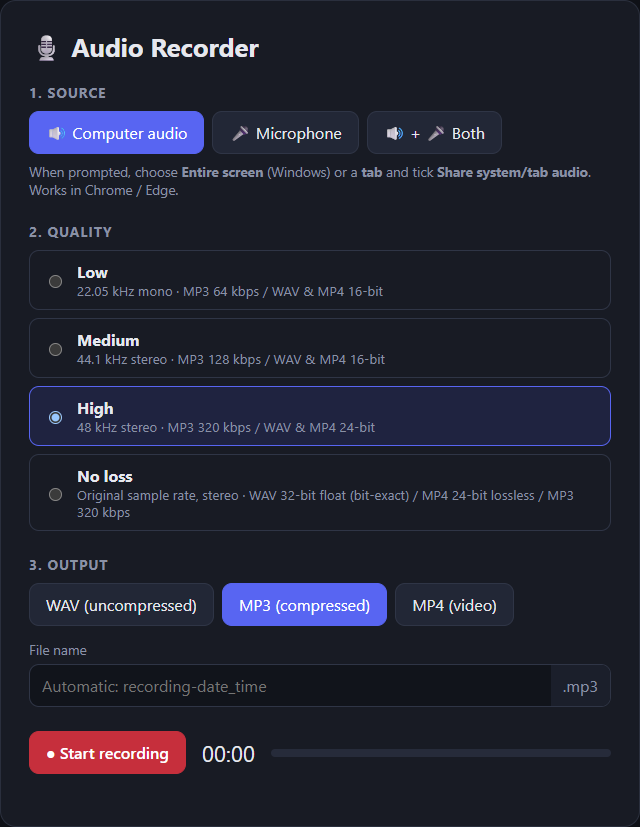
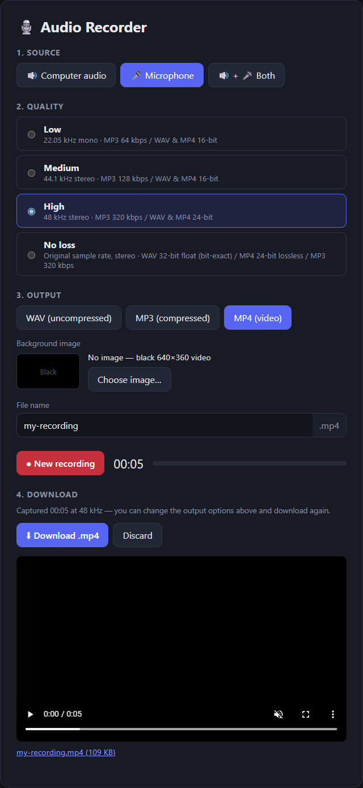

# Audio Recorder

Audio Recorder is a browser-based app for recording **computer (system) audio**, your **microphone**, or **both mixed together**. Capture audio from a tab, narrate over computer audio, or record a voice note without installing desktop software.

Choose a quality preset, start and stop recording, then download as **WAV**, **MP3**, or **MP4 video** with a black background or an image of your choice. You can edit the file name and output options before, during, or after recording, preview the exported file, and download the same recording in multiple formats.

Recording and encoding happen locally in your browser: the app does not upload your audio to a server. Built with React, TypeScript, and Vite.

## Screenshots

### Recording options

Choose the audio source, quality, output format, and file name.



### MP4 export and preview

Choose a background image or keep the black background, then download and preview your video.



## Features

- Quality presets: Low (22.05 kHz mono), Medium (44.1 kHz), High (48 kHz / 24-bit / 320 kbps), **No loss** (bit-exact 32-bit float WAV).
- Output options (format WAV / MP3 / MP4, MP4 background image, file name) can be set before, during or after recording. After stopping, download — a preview player is shown, and you can change the options and download again from the same recording.
- MP4 contains a still video track — black 640×360 by default, or a **background image** you pick (shown whole at its own aspect ratio, scaled to max 1920px) — and **lossless FLAC audio**: the same 16/24-bit samples as the WAV export (*No loss* is stored as 24-bit, since FLAC has no float format — inaudible difference, ~144 dB dynamic range). It plays in Windows Media Player / Films & TV, Chrome/Edge, Firefox, VLC and ffmpeg-based players.
- MP3 for *No loss* / *High* is encoded at the MP3 maximum (320 kbps CBR, full stereo, original sample rate). Integer conversion uses TPDF dither, and recordings that exceed full scale are scaled down instead of clipped.

## Run locally

```bash
npm install
npm run dev
```

## Notes

- **Mobile:** microphone recording works in supported, up-to-date mobile browsers over **HTTPS**. The app selects the microphone when screen capture is unavailable. Open the deployed HTTPS URL (not an `http://192.168...` development URL), allow microphone access, and keep the page foregrounded with the screen unlocked. System audio generally cannot be captured on mobile. WAV and MP3 export locally; MP4 export also requires browser video-encoding support, and playback support varies by device. Long recordings can exhaust a phone's memory.
- System audio uses `getDisplayMedia` and works in **Chrome / Edge**. In the share dialog pick *Entire screen* (Windows) or a tab and enable *Share system/tab audio*. Firefox/Safari don't support capturing system audio — use the mic mode there.
- Audio is captured as raw PCM through an AudioWorklet (`public/recorder-worklet.js`) and only encoded on download, so quality/format can be applied losslessly. Raw capture uses ~23 MB per minute of RAM.
